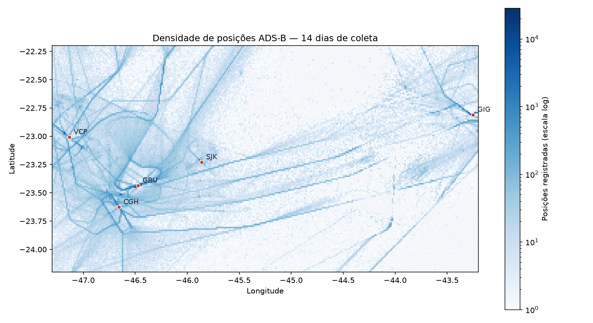
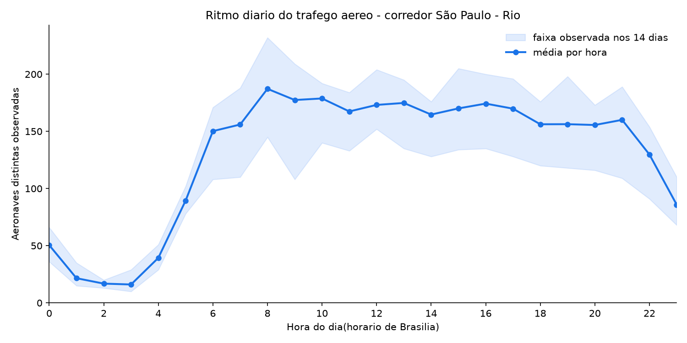
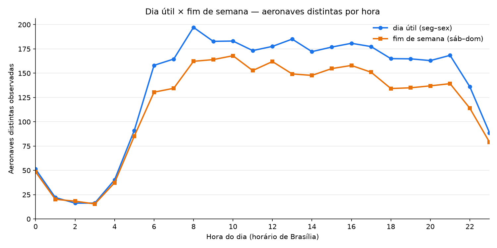

# Tráfego aéreo no corredor São Paulo–Rio

Coleta e análise de dados ADS-B em tempo real, usando a API pública da
[OpenSky Network](https://opensky-network.org). O coletor rodou de forma autônoma
por 14 dias, acumulando um conjunto de dados próprio sobre o espaço aéreo entre
São Paulo, o Vale do Paraíba e o Rio de Janeiro.



*As rotas não foram desenhadas: emergem da acumulação de 713.767 posições
registradas ao longo de duas semanas.*

---

## O problema

Toda aeronave comercial transmite continuamente sua posição, altitude e velocidade
por rádio (ADS-B). Esses sinais são captados por uma rede mundial de receptores
voluntários e disponibilizados publicamente.

A pergunta que guiou o projeto: **é possível, partindo do zero, construir um
conjunto de dados próprio sobre o espaço aéreo da minha região e extrair dele
padrões reais?**

Três perguntas específicas foram definidas antes de escrever qualquer código:

1. Qual é o ritmo diário e semanal do tráfego no corredor?
2. Como o tráfego se distribui geograficamente?
3. Qual a cobertura real dos dados coletados — e onde eles falham?

---

## Método

**Coleta.** Um script em Python consulta a API da OpenSky a cada 60 segundos,
delimitando uma caixa geográfica de 8,2 graus² (−24,2° a −22,2° de latitude,
−47,3° a −43,2° de longitude). Cada resposta é gravada em CSV, particionado por dia.

A autenticação usa OAuth2 *client credentials*, com renovação de token acionada
pela resposta `401` da própria API.

**Período.** 10 a 25 de outubro de 2026. A análise usa os 14 dias completos entre
11 e 24 de outubro — duas ocorrências de cada dia da semana.

**Volume.** A coleta bruta produziu 728.105 registros em 20.445 ciclos. Após
descartar os dias parciais das pontas e 5 horas com coleta incompleta (de 336),
a análise trabalha com **713.767 registros** e **2.684 aeronaves distintas**.

**Cobertura: 97,6%** dos minutos da janela de coleta.

---

## Resultados

### O céu tem um ritmo diário de 11 para 1



O movimento vai de **16 aeronaves** no vale das 2h–3h da madrugada a **187** no pico
das 8h. A subida matinal é mais íngreme que a queda noturna: leva quatro horas para
subir e seis para descer.

Entre 8h e 21h o tráfego não forma um pico isolado, e sim um platô sustentado entre
157 e 187 aeronaves — assinatura de um corredor operando próximo à saturação.

### No fim de semana, o céu acorda duas horas depois



Entre 0h e 5h as duas curvas são indistinguíveis: o tráfego noturno não depende do
dia da semana. A diferença abre às 6h e se mantém, com média de **+18,5 aeronaves**
em favor dos dias úteis e máximo de **+35,8 às 13h**.

O deslocamento do pico é o achado mais nítido: **8h nos dias úteis, 10h no fim de
semana.**

### Composição do tráfego

| Tipo de operação | Registros | Participação |
|---|---|---|
| Voo de companhia aérea (`TAM3419`) | 566.924 | 79,4% |
| Matrícula — aviação executiva e geral (`PR-ABC`) | 128.337 | 18,0% |
| Sem identificação transmitida | 18.275 | 2,6% |

A classificação usa o formato do callsign, não um cadastro externo: três letras
seguidas de dígito indicam voo de companhia; o restante, matrícula. É uma heurística,
e está documentada como tal.

Quase um quinto do tráfego observado é aviação executiva e geral — proporção
coerente com uma região que abriga fabricantes e aeroportos executivos.

Entre os voos identificados, 231 registros pertencem a duas aeronaves da própria
Embraer (prefixo de callsign `EMB`), operando a partir de São José dos Campos.

---

## Limitações

Estas limitações são parte do resultado, não ressalvas protocolares.

**A cobertura ADS-B não é uniforme.** A OpenSky depende de receptores voluntários.
Áreas de baixa densidade no mapa podem refletir pouco tráfego **ou** poucos
receptores — os dados coletados não permitem distinguir os dois casos.

**Rádio é linha de visada.** Aeronaves em altitude de cruzeiro são detectadas a
centenas de quilômetros; aeronaves próximas ao solo, apenas por receptores próximos.
Decolagens e pousos estão sistematicamente sub-representados.

**Amostragem a cada 60 segundos.** Uma aeronave a 250 m/s percorre 15 km entre duas
observações. Trajetórias são aproximações, não traçados contínuos.

**O campo `category` do ADS-B é inútil na prática.** Apenas **0,39%** dos registros
trouxeram categoria de aeronave preenchida. A especificação prevê o campo; o tráfego
observado raramente o transmite. Por isso a classificação foi feita pelo callsign.

**O campo `squawk` veio vazio em 93,4%** dos registros.

**Uma anomalia nos gráficos era defeito da coleta, não do céu.** Um vale acentuado
às 14h do dia 21/10 levou a uma verificação: naquela hora o coletor registrou apenas
13 dos 60 ciclos esperados. Ao todo, **5 das 336 horas (1,5%)** tiveram coleta
incompleta e foram removidas da análise. O critério está no código, não foi aplicado
manualmente.

**Duas semanas não mostram sazonalidade.** Os dados descrevem ritmo diário e semanal.
Qualquer afirmação sobre tendência ou efeito sazonal estaria fora do que foi medido.

---

## Reproduzir

```bash
pip install -r requirements.txt
```

Crie um arquivo `credenciais.py` com as suas credenciais da OpenSky
([como obter](https://opensky-network.org/my-opensky/account)):

```python
CLIENT_ID = "seu_client_id"
CLIENT_SECRET = "seu_client_secret"
```

Coleta:

```bash
python coletor.py
```

Análise: abra `analise.ipynb` e execute todas as células.

---

## Estrutura

```
config.py              Parâmetros e decisões do projeto
coletor.py             Coleta contínua, com retomada automática
conferir.py            Diagnóstico de integridade dos dados
analise.ipynb          Tratamento, análise e gráficos
iniciar_coletor.bat    Execução contínua com reinício automático
dados/                 CSVs, um por dia
graficos/              Figuras geradas
```

---

## Decisões técnicas

**CSV em vez de banco de dados.** Os dados são somente-acréscimo e cabem em memória.
Um banco adicionaria complexidade sem resolver nenhum problema existente.

**Intervalo de 60 segundos.** Consome 1.440 créditos diários de uma cota de 4.000
(36%), preservando margem para repetições e testes sem interromper a coleta.

**Caixa ampla, análise estreita.** A caixa cobre mais do que o recorte de interesse.
Filtrar dados coletados custa uma linha; coletar retroativamente é impossível.

**Renovação de token por reação, não por previsão.** O código responde ao `401`
emitido pela API em vez de calcular a expiração. Reagir ao fato é mais confiável do
que prever o fato.

**UTC no armazenamento, horário local na apresentação.** Imuniza os dados contra
fuso e horário de verão; a conversão ocorre apenas na análise.

**Ausência de dado nunca vira zero.** Zero é um valor válido de altitude e velocidade.
Campos vazios permanecem vazios e são tratados como ausentes.

**Dias e horas parciais descartados.** Comparações entre dias exigem janelas
equivalentes. O primeiro e o último dia, e as horas com coleta incompleta, ficam
fora das agregações.

**Contagem por aeronave distinta, não por registro.** Uma aeronave aparece em dezenas
de observações ao atravessar a área. Contar linhas mediria tempo de permanência,
não volume de tráfego.

---

## Fonte dos dados

[The OpenSky Network](https://opensky-network.org) — dados abertos para uso
não comercial e de pesquisa.

> Bringing up OpenSky: A large-scale ADS-B sensor network for research.
> Schäfer, M., Strohmeier, M., Lenders, V., Martinovic, I., Wilhelm, M.
> *ACM/IEEE IPSN*, 2014.

---

## Sobre

Projeto pessoal de Davi de Oliveira Parada, estudante de Ciência e Tecnologia na
UNIFESP São José dos Campos.

Comecei sem nunca ter usado uma API REST, autenticação OAuth2 ou coleta agendada.
Aprendi cada uma dessas coisas ao longo do projeto, com IA como tutor e a
documentação da OpenSky como referência. A seção de decisões técnicas acima existe
porque minha regra foi não deixar nenhuma linha no código sem entender por que ela
estava ali.